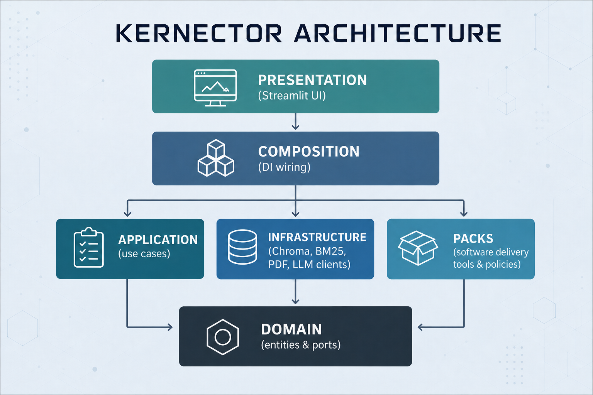

# Case study: Issue → Test Design with Kernector

Capstone case study for [#342](https://github.com/mahmoudazaid/Kernector/issues/342).
Demo runbook: [demo.md](demo.md). Evidence: [README.md](README.md#evidence-tracker).

## 1. The user's job and problem

QA engineers on delivery teams turn work items (GitHub Issues, stories) into
test coverage. For each Issue they must decide what to test, write
cases with steps and expected results (or Gherkin), and keep those cases
traceable to the Issue as it changes. The evidence is scattered across the
tracker, documents, and repositories. The work is repetitive, and coverage
gaps show up late.

## 2. Current alternative

- **Manual authoring:** read the Issue and write cases by hand in a
  spreadsheet, Xray, or a `.feature` file. This is slow and inconsistent
  across engineers, and nothing links a case back to the evidence that
  justified it.
- **Generic chatbot:** paste the Issue into a general assistant. Output is
  fast, but it is ungrounded, it may invent behavior the Issue never states,
  and there is no review step, no structure, and no way to see when the Issue
  changed under the generated cases.

## 3. Distinctive approach

Kernector treats test design as a **human-in-the-loop workflow over live
evidence**, not a single prompt:

1. **Live evidence, not retrieval.** Test Design reads the Issue directly from
   the connected tracker at start, and again at generate time. It does not
   search a stale index.
2. **Two explicit steps.** The model *suggests* coverage candidates. The user
   keeps, drops, or adds candidates and picks **manual** or **Cucumber** per
   test. Only then are detailed cases generated.
3. **Fail closed on change.** Each draft stores an evidence fingerprint. If
   the Issue changed since it was confirmed, generation stops without writing.
4. **User edits are protected.** Regeneration never overwrites a case the
   user edited unless explicitly asked. Drafts use version checks
   (compare-and-swap), so concurrent edits do not silently clobber each other.
5. **Same workflow in two front doors.** The Next.js workspace and the MCP
   server (Cursor, Claude Code) drive the same pack workflow. When Kernector
   has no tracker connection, an assistant can supply the Issue text itself,
   and the draft is marked `evidence_origin: client_supplied`.

## 4. Architecture (high level)

- **Core** (`domain/`, `application/`) is domain-agnostic: documents,
  provenance, chunking, retrieval, and grounded ask. It holds no
  ticket or test types.
- **Software Delivery pack** (`packs/software_delivery/`) owns Test Design:
  candidate suggestion, case generation, draft models, and MCP tool
  dispatch.
- **Composition** (`composition/`) is the only wiring root. It enables packs
  through an explicit allowlist (`DOMAIN_TOOL_PACKS`), registers Test Design
  sources (GitHub Issues, plus Jira Data Center when configured), and binds
  everything to a workspace.
- **Presentation:** FastAPI (`/api/v1/test-design/*`) for the Next.js UI, and a
  Streamable HTTP MCP server with allowlisted tools for coding assistants.

Details: [ARCHITECTURE.md](../../ARCHITECTURE.md),
[pack README](../../packs/software_delivery/README.md#test-design-workflow-293--300).

## 5. Data handling

- **Credentials stay on the server.** OAuth grants live in gitignored files
  (mode `0600`). The browser and MCP results never see tokens, workspace ids,
  or provider data.
- **Evidence is untrusted input.** Issue text and client-supplied text are
  wrapped in defanged evidence delimiters before reaching the model. The
  supplied text has a size budget and is never truncated, so acceptance
  criteria always reach the model in full.
- **Model output is labeled.** MCP results mark model-generated text with
  `untrusted_model_output`. User-added candidates are not marked.
- **Traceability.** Candidates keep evidence references to the Issue
  (`issue:<node id>`), and drafts record their source provider and evidence
  origin (`live` or `client_supplied`).
- **Scoped storage.** Drafts are workspace-scoped. A draft from another
  workspace looks exactly like a missing one (`not_found`).
- **Logs carry metadata only.** Structured logs contain ids, outcomes,
  latency, model, and token counts. They never contain document text,
  prompts, secrets, tool arguments, or exception messages.
- **Nothing is published without the user.** Drive and Xray exports are
  separate, user-approved actions outside the Capstone path.

### Bias

Generated cases follow the issue the engineer selected. They do not fill gaps
from the model's general knowledge of similar products.

- **A person chooses coverage first.** The model suggests candidates. The
  engineer keeps, drops, or adds them, and picks manual or Cucumber, before
  any detailed case is written.
- **Generation uses the issue text.** Cases are produced from that evidence,
  wrapped as untrusted input. They are not retrieved from a stale index of
  other documents.
- **Thin issues are not completed by invention.** An issue with no description
  and no acceptance criteria is insufficient evidence. A case marked
  `insufficient_evidence` has empty preconditions, steps, and Gherkin. The
  generator is instructed not to invent behavior the issue does not state.

## 6. Evaluation results

**TBD. Blocked on [#341](https://github.com/mahmoudazaid/Kernector/issues/341)**
(Issue → Test Design coverage quality with Langfuse experiments and a
versioned fixture baseline). This section will cite the #341 baseline report
and dataset once that issue merges. Until then, no quality numbers are claimed.

The existing offline RAG and judge evaluation lives in
[data/eval/README.md](../../data/eval/README.md). It covers grounded ask,
not Test Design coverage.

## 7. User feedback

**TBD. Blocked on [#343](https://github.com/mahmoudazaid/Kernector/issues/343)**
(observe five QA users on the Issue → Test Design workflow and ship
before/after improvements). This section will summarize the observed problems
and the before/after changes, with links to the #343 artifacts.

## 8. Hardest technical decision

**Keep the core domain-agnostic and put Test Design in an optional pack**
([ADR 0001](../adr/0001-domain-agnostic-knowledge-foundation.md); direction
continued in [ADR 0011](../adr/0011-project-intelligence-foundation.md)).

Early Kernector had a shared `Ticket` type and SDLC vocabulary in the core.
Building Test Design directly on those types would have been faster. But it
would have tied every connector, prompt, and API to one product shape, and it
would have made the platform hard to reuse for anything that is not a ticket.

Trade-offs accepted:

- **More wiring.** Composition must activate packs through an allowlist,
  register Test Design sources, and project pack results onto HTTP and MCP
  schemas. Packs never import composition or the UI. Architecture tests enforce
  these layer boundaries.
- **Pack-aware edges.** HTTP routes for Test Design are always mounted, but
  return `test_design_unavailable` when the pack is off, so the API contract
  does not change shape. MCP tools appear only when the pack is on and they
  are allowlisted.
- **Payoff.** New trackers arrived as source adapters without touching the
  workflow: GitHub Issues first, then Jira Data Center behind the same
  registry. The same workflow also reached a second front door (MCP)
  without being forked.

A related decision was to read **live evidence** instead of retrieving from the
vector index. Live reads cost a tracker call per start and generate, and they
need a connection ([#302](https://github.com/mahmoudazaid/Kernector/issues/302)
tracks public Issues without one). In exchange, Kernector can detect a changed
Issue and fail closed instead of generating against stale text.

## 9. Next steps

- Land the Test Design evaluation baseline
  ([#341](https://github.com/mahmoudazaid/Kernector/issues/341)) and gate
  prompt changes on it.
- Run the five-user study and ship the before/after fixes
  ([#343](https://github.com/mahmoudazaid/Kernector/issues/343)).
- Allow public GitHub Issues without a connection
  ([#302](https://github.com/mahmoudazaid/Kernector/issues/302)).
- Finish the canonical operator guide
  ([#105](https://github.com/mahmoudazaid/Kernector/issues/105)).

## Not claimed

The Capstone does **not** claim Jira connectors, project memory
([#331](https://github.com/mahmoudazaid/Kernector/issues/331),
[#337](https://github.com/mahmoudazaid/Kernector/issues/337)), or MCP Admin
expansion as deliverables. Some of these exist in the repository, but they
are outside the Capstone scope.
